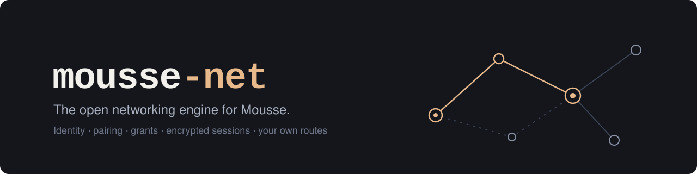

<p align="center">
  
</p>

# mousse-net

**The open networking engine for [Mousse](https://github.com/mousse-agent/mousse).**

[](https://github.com/mousse-agent/mousse-net/actions/workflows/ci.yml)
[](LICENSE)

`mousse-net` is the Rust engine behind Bridge, which lets you work with agents on your other computers from Mousse. The engine handles device identity, pairing, host grants, encrypted sessions and routing.

Devices can pair in person with a QR code or remotely with a Send link and a six-digit code (CPace). Sessions use TLS 1.3 with short-lived certificates signed by each device and hybrid post-quantum key exchange on native targets. Computers that support protocol minor 3 can make calls in both directions over one connection, subject to each computer's grant.

Connections can use the local network, your own routes (such as Tailscale, SSH, a port forward or a tunnel), or a relay. When a relay route is configured, the helper tries it first while it checks whether a direct route can take over.

## Status

- **Phases 0, 1a and 1b** added the core, simulator, owner test kit, desktop pairing and user-provided routes. The engine is integrated into the Mousse desktop app.
- **Phases 3 and 4** added the self-hosted relay, headless daemon and the engine's side of Mousse Plus relay admission, leases and usage reporting. The relay has tooling for reproducible builds and minisign signing.
- **On the roadmap** are native phone support (Phase 2), a browser client (Phase 5) and shared rosters (Phase 6).

Mousse builds fetch a pinned commit of this repository, compile `mousse-helper` from source and bundle the binary with the app. [Pinned commit](https://github.com/mousse-agent/mousse/blob/master/native/net-helper/ENGINE_COMMIT) · [Build script](https://github.com/mousse-agent/mousse/blob/master/scripts/build-net-helper.mjs)

## What's here

| Path | What it is |
|---|---|
| [`crates/mousse-net-core`](crates/mousse-net-core) | State machines for identity, pairing (CPace), grants, session, mux, path choice, allow-sets and the relay protocol. No I/O; builds for `wasm32`. |
| [`crates/mousse-net-io`](crates/mousse-net-io) | tokio adapters: TLS sessions, TCP/SSH/WebSocket pipes, the session driver, keystores and mDNS discovery. |
| [`crates/mousse-sim`](crates/mousse-sim) | Seeded, deterministic simulator for core and relay drills. Every drill replays from a seed. |
| [`crates/mousse-helper`](crates/mousse-helper) | Desktop helper, CLI and headless server daemon: pairing, grants, path switching and terminal channels. |
| [`crates/mousse-relay`](crates/mousse-relay) | Self-hosted relay binary that joins authorized connections and forwards encrypted traffic. |
| [`crates/mousse-relay-plus`](crates/mousse-relay-plus) | Hosted relay side of Mousse Plus: pinned issuer keys, lease admission and usage reports. |
| [`crates/mousse-check`](crates/mousse-check) | Owner test kit. Its automated checks use controls that must fail. |
| [`spec/`](spec/) | The wire spec, CPace, relay spec, test vectors, threat model and privacy notes. |
| [`checks/`](checks/) | Phase check manifests, device roster and signed results. |
| [`interop/`](interop/) | A second implementation written from the spec alone. |
| [`release/`](release/) | Reproducible container build, OCI image, minisign signing and installer for `mousse-relay`. |
| [`docs/`](docs/) | Phase plan, per-phase designs, limits, headless daemon guide and relay release guide. |

## Build and test

Needs Rust 1.96 and the `wasm32-unknown-unknown` target.

```sh
cargo fmt --all --check
cargo clippy --workspace --all-targets --all-features -- -D warnings
cargo test --workspace
cargo check -p mousse-net-core --target wasm32-unknown-unknown
```

The core's tests also run on wasm32 under Node, with `wasm-bindgen-test-runner`
0.2.130 (from `wasm-bindgen-cli`, the same version as wasm-bindgen) on `PATH`:

```sh
CARGO_TARGET_WASM32_UNKNOWN_UNKNOWN_RUNNER=wasm-bindgen-test-runner \
  cargo test -p mousse-net-core --target wasm32-unknown-unknown
```

Run a phase's checks and must-fail controls, or report the results already stored. Available phases are `phase0`, `phase1a`, `phase1b`, `phase3` and `phase4`.

```sh
cargo run -p mousse-check -- phase0
cargo run -p mousse-check -- report phase0
```

## Read more

- [Design and phases](docs/PLAN.md) ([Phase 1a](docs/phase1a-design.md), [Phase 1b](docs/phase1b-design.md), [Phases 3–4](docs/phase34-design.md))
- [Headless daemon](docs/headless.md)
- [Relay releases and installation](docs/release.md)
- [Specification](spec/README.md): wire format, CPace, relay, vectors, threat model, privacy
- [Owner checks](checks/README.md)
- [Contributing notes](AGENTS.md)

## License

[MIT](LICENSE)
